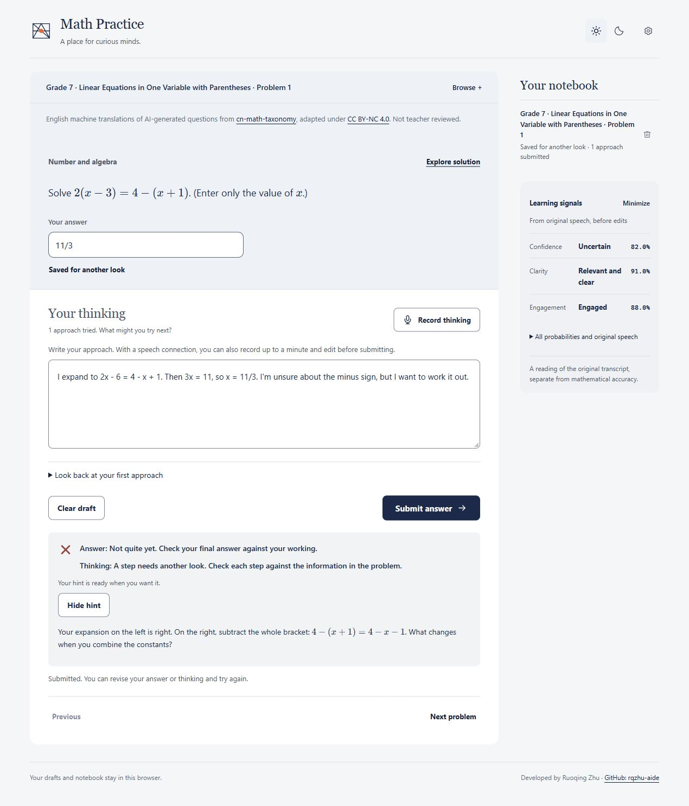

# math-practice

Repository: [rqzhu-aide/math-practice](https://github.com/rqzhu-aide/math-practice).

A local mathematics practice space developed by [Ruoqing Zhu](https://github.com/rqzhu-aide).
Includes **3,355 processed Chinese curriculum questions**, displayed in English,
with answers, worked solutions, diagrams, and preserved Chinese originals.
These are adapted from the Chinese K-12 mathematics repository
[xiaoyang111222/cn-math-taxonomy](https://github.com/xiaoyang111222/cn-math-taxonomy),
with source attribution and modification details preserved. There is no frontend
build step.

We are currently requesting permission from the **Mathematical Association of
America (MAA)** to include **American Mathematics Competitions (AMC)** questions.
Permission is pending, and AMC questions are not included in this repository.

## Interactive practice



*Illustrative session in the actual UI, using a sample transcript and model
responses. Interactive model features require the optional connections below.*

- **Record thinking:** speak for up to a minute, then review and edit the
  transcription alongside your written work.
- **Get feedback:** check the final answer and mathematical reasoning separately.
  An optional inference model provides deeper review and hints that the student
  reveals when ready.
- **See learning and emotion-related signals:** the backend evaluates expressed
  confidence, clarity, and engagement or frustration from the original speech
  transcript. These provisional text-based observations are separate from
  mathematical correctness; they are not validated measurements of emotion or
  fixed learner traits.

**Planned development:** use practice history, reasoning feedback, and learning
signals to recommend suitable questions and adapt study approaches, pacing, and
hint timing. These recommendations are not implemented yet.

## Start practicing

Install **Python 3.11 or newer** for your user or machine. No Python packages or
model services are needed for ordinary practice.

From this repository's root, run:

```sh
python scripts/serve_math_practice.py
```

Open [Math Practice](http://127.0.0.1:8877/math-practice/). Keep the terminal running.
On Windows, you can instead double-click **Start Math Practice.cmd** to start the
server in the background and open practice. If the port is occupied, add
`--port 8878` to the Python command and use that port in the browser.

Choose **Try a problem** or browse by level, unit, and topic. Enter an answer,
write your thinking, and submit. Without models, known answers are checked
locally; reasoning and unfamiliar symbolic or open answers are not automatically
judged. Add some thinking to open the worked solution. Drafts and your notebook
stay in the browser. Opening `math-practice/index.html` directly also supports
practice without model services; microphone input needs the local server.

## Optional local models

Open **Settings → Connection settings**. Each connection is independent. Enter
your server address and model ID, add a key only if your server requires one,
then save and test that connection. Leave its address and model blank to disable it.

| Connection | Adds | Required API |
| --- | --- | --- |
| Decision model | Checks thinking and assesses original speech text | `GET /v1/models`, `POST /v1/systemone` with rubric choices and probabilities |
| Speech to text | Turns recorded thinking into an editable draft | `GET /v1/models`, `POST /v1/audio/transcriptions` accepting multipart WAV |
| Inference model | Deeper review and progressive hints when an answer or explanation needs another look | Compatible `GET /v1/models` and `POST /v1/chat/completions`, supporting JSON responses |

Use an address such as `http://localhost:8000` and the model ID reported by your
own server. An address ending in `/v1` is also accepted. For a local inference
model, select **Compatible API**. A general chat model does not automatically
implement the decision API; use a service that supports `/v1/systemone`.

Deeper review of questions with figures also needs an inference model that accepts
image content. Install its image helpers in your shared Python installation:

```sh
python -m pip install --user PyMuPDF Pillow
```

The optional **Codex account** connection is separate from local-model setup.
It requires your own user-wide Codex installation, login, and shared
`openai-codex` Python package. It is not enabled by default.

Settings are stored in ignored `math-practice/config.json`. The server creates
it with empty connections on first start. You may also copy
`math-practice/config.example.json` to that path and edit it, then use
**Load Configuration**. The example contains no working credentials or private
addresses. Startup does not run model tests or inference.

## Data and privacy

The server listens on this computer's loopback interface only. Keys stay in the
local backend and are not served as static files. When you enable a model,
the relevant submitted work or recorded audio is sent to your chosen service.
The harness does not save audio. Runtime logs and optional account work files
stay in ignored `.local/`.

The Git allowlist includes application code, bundled assets, tests, documentation
and its UI screenshot, and the processed Chinese bank. It excludes private
configuration, logs, caches, raw source collections, processing reports, and AMC
content. Do not force-add local
files with `git add -f`; review staged changes before publishing.

The question bank and its adaptations retain upstream **CC BY-NC 4.0** terms,
attribution, and modification notices. Both source questions and translations
are AI-generated and not teacher reviewed. See
[bank attribution](cn-math-bank/NOTICE.md) and
[third-party notices](THIRD_PARTY_NOTICES.md). No new license for the harness code
is granted by the question-bank license.
